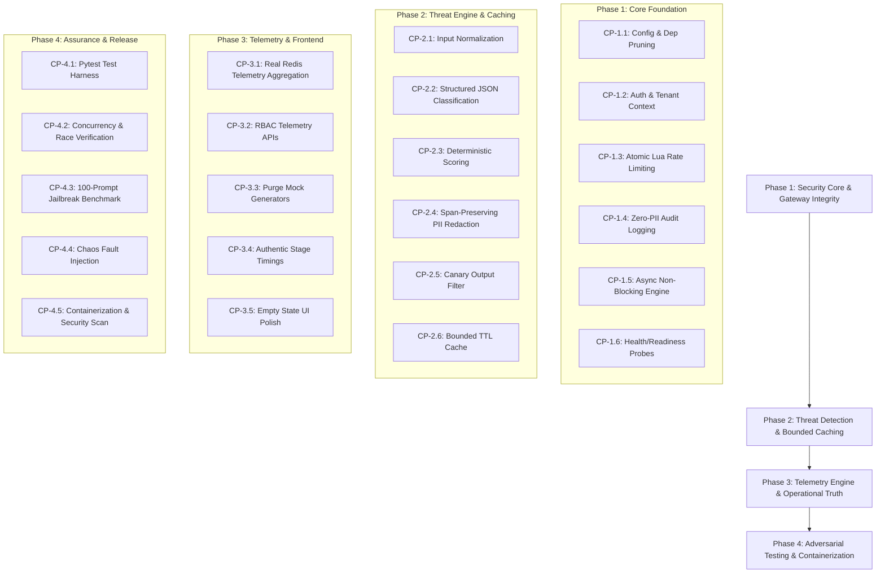

# ShieldProxy Hardening Implementation Plan

**Target Architecture:** Production-Grade Enterprise LLM Security Gateway<br>
**Base Repository:** `C:\Users\gopal\ShieldProxy-Hardened`<br>
**Target Evaluation Score:** 8.15 / 10.0 (Baseline: 2.38 / 10.0)<br>
**Execution Strategy:** 4 Sequential Phases, Checkpoint Gates, Test-Driven Verification<br>
**Status:** Pre-Implementation Phase (Read-Only Planning)<br>

---

## 1. Strategic Objectives & Architectural Vision

The objective of this hardening program is to evolve ShieldProxy from an early-stage conceptual prototype into a robust, independently verifiable, and production-ready LLM security gateway.

### Target Rubric Progression

```
[ Baseline: 2.38 / 10 ]<br>
       │
       ▼ (Phase 1: Security Core & Gateway Integrity)
[ Post-Phase 1: 5.20 / 10 ]
       │
       ▼ (Phase 2: Threat Detection Robustness & Bounded Caching)
[ Post-Phase 2: 6.85 / 10 ]
       │
       ▼ (Phase 3: Telemetry Engine & Operational Truth)
[ Post-Phase 3: 7.45 / 10 ]
       │
       ▼ (Phase 4: Adversarial Benchmarking, Chaos & CI/CD)
[ Final Target: 8.15 / 10 ]
```

---

## 2. Four-Phase Sequential Roadmap Overview



---

## 3. Phase 1: Security Core & Gateway Integrity

**Goal:** Establish a secure perimeter, enforce authentication and tenant isolation, eliminate raw prompt logging, ensure rate limit atomicity, and resolve event loop blocking.

### Checkpoint CP-1.1: Dependency Pruning & Type-Safe Configuration
- **Addressed Findings:** SEC-DEP-01, SEC-CONFIG-02
- **Action:**
  1. Remove `llama-cpp-python` and `scikit-learn` from `requirements.txt`.
  2. Add `pydantic-settings>=2.2.0`, `cachetools>=5.3.0`, `pytest>=8.0.0`, `pytest-asyncio>=0.23.0`, `respx>=0.21.0`.
  3. Refactor `config.py` using `pydantic_settings.BaseSettings` with strict types, default values, and `.env` parsing.
  4. Restrict CORS origins in `main.py` using explicit environment whitelist.
- **Verification Command:**
  ```bash
  pip install -r backend/requirements.txt
  python -c "from config import settings; print(settings.model_dump())"
  ```
- **Expected Results:** Fast installation without C++ compilation requirements; valid settings object printed.
- **Exit Criteria:** `config.py` rejects invalid non-numeric `RATE_LIMIT_RPM` during startup; unused packages removed.
- **Dependencies:** None.

---

### Checkpoint CP-1.2: Authentication, Tenant Isolation & Request Body Limits
- **Addressed Findings:** SEC-AUTH-01, SEC-AUTH-02, SEC-AUTH-03, SEC-CONFIG-01
- **Action:**
  1. Add ASGI request body size limiter middleware (rejection of bodies > 64 KB with HTTP 413).
  2. Implement `backend/middleware/auth.py` providing `get_current_tenant` dependency.
  3. Validate `X-API-Key` or `Authorization: Bearer <key>` against a secure tenant store.
  4. Extract `tenant_id` and rate limit tier from authenticated credentials. Drop untrusted caller-supplied `client_id` from `ChatRequest`.
  5. Add admin session authentication for `/v1/dashboard/*` endpoints.
- **Verification Command:**
  ```bash
  pytest tests/test_auth.py -v
  ```
- **Expected Results:**
  - Anonymous request to `/v1/chat` returns 401 Unauthorized.
  - Large payload (>64KB) returns 413 Payload Too Large.
  - Valid key passes and resolves internal tenant identity.
- **Exit Criteria:** 100% of gateway and dashboard routes require verified authentication.
- **Dependencies:** CP-1.1.

---

### Checkpoint CP-1.3: Atomic Redis Lua Rate Limiter with In-Memory Degraded Mode
- **Addressed Findings:** SEC-RATE-01, SEC-RATE-02, SEC-RATE-03
- **Action:**
  1. Rewrite `RateLimiter.check()` using an atomic Redis Lua script that calculates continuous token refills and decrements in a single operation.
  2. Implement thread-safe in-memory sliding window rate limiter fallback with `asyncio.Lock` when Redis is unreachable.
  3. Enhance `MockRedis` in `utils/redis_client.py` to support TTL expiration and simulated time.
- **Verification Command:**
  ```bash
  pytest tests/test_rate_limiter.py -v
  ```
- **Expected Results:**
  - Concurrent burst test (20 simultaneous calls against 5 RPM) allows exactly 5 and returns 429 for 15.
  - Disconnecting Redis smoothly triggers in-memory throttling without failing open.
- **Exit Criteria:** Concurrency race conditions eliminated; fail-open behavior prevented.
- **Dependencies:** CP-1.1, CP-1.2.

---

### Checkpoint CP-1.4: Zero-PII Audit Logging & Privacy Redaction
- **Addressed Findings:** SEC-DATA-01, SEC-DATA-02, SEC-BUG-01
- **Action:**
  1. Modify `chat.py` to ensure `req.message` is **never passed** to `audit_logger.log()`.
  2. Reorder pipeline logging: log safe requests **after** LLM completion, recording real `latency_ms` (resolving SEC-BUG-01).
  3. In `audit_logger.py`, derive `prompt_preview` strictly from scrubbed text with entity spans masked (`[REDACTED]`). Store SHA-256 HMAC for searchability.
  4. Sanitize `/v1/dashboard/alerts` API responses to ensure zero raw prompt previews leak.
- **Verification Command:**
  ```bash
  pytest tests/test_audit_privacy.py -v
  ```
- **Expected Results:** Audit logs in Redis streams contain 0 instances of raw PII; safe request logs record true non-zero latency.
- **Exit Criteria:** Raw prompts and unscrubbed PII are completely purged from storage and telemetry.
- **Dependencies:** CP-1.2.

---

### Checkpoint CP-1.5: Async Non-Blocking Pipeline & Gateway Timeout Management
- **Addressed Findings:** SEC-ASYNC-01, SEC-ASYNC-02, SEC-AI-05
- **Action:**
  1. Remove import-time synchronous network probe from `threat_classifier.py`.
  2. Migrate `ThreatClassifier` to `AsyncOpenAI` client or offload synchronous calls via `asyncio.to_thread()`.
  3. Replace `time.sleep()` in `llm_gateway.py` with `await asyncio.sleep()`.
  4. Reuse a single persistent `AsyncOpenAI` client in `LLMGateway` with connection pooling and a strict 15.0s timeout.
- **Verification Command:**
  ```bash
  pytest tests/test_async_concurrency.py -v
  ```
- **Expected Results:**
  - 10 concurrent requests finish in ~1x single request latency.
  - Hanging LLM mock triggers 504 Gateway Timeout cleanly after 15s.
- **Exit Criteria:** Zero synchronous blocking calls on the asyncio event loop.
- **Dependencies:** CP-1.1.

---

### Checkpoint CP-1.6: Accurate Readiness & Liveness Probes
- **Addressed Findings:** SEC-OPS-01
- **Action:**
  1. Create `/health/live` returning 200 process status.
  2. Create `/health/ready` performing active health checks: Redis `ping()`, Ollama tags probe, and memory usage verification.
  3. Return HTTP 503 Service Unavailable with diagnostic payload if dependencies are dead.
- **Verification Command:**
  ```bash
  pytest tests/test_health_probes.py -v
  ```
- **Expected Results:** Readiness probe returns 200 when dependencies are up; returns 503 when Redis or Ollama is down.
- **Exit Criteria:** Production-grade readiness probing for container orchestrators.
- **Dependencies:** CP-1.1.
## 4. Phase 2: Threat Detection Robustness, Output Filtering & Bounded Caching

**Goal:** Strengthen threat classification, eliminate pseudorandom confidence scores, close regex evasion blind spots, implement true bounded caching, and secure output filtering.

### Checkpoint CP-2.1: Multi-Representation Input Normalization
- **Addressed Findings:** SEC-AI-03
- **Action:**
  1. Add pre-classification text normalization layer:
     - Base64 / Hex token detection and decoding.
     - URL decoding and unescape entities.
     - Unicode homoglyph normalization (NFKC) and zero-width character stripping.
     - Markdown tag and whitespace canonicalization.
  2. Evaluate both raw text and normalized canonical representations against classifier rules.
- **Verification Command:**
  ```bash
  pytest tests/test_input_normalization.py -v
  ```
- **Expected Results:** Base64-encoded jailbreak prompt (`SWdub3Jl...`) is decoded and blocked as `PROMPT_INJECTION`.
- **Exit Criteria:** Obfuscated and encoded prompts are normalized and detected reliably.
- **Dependencies:** CP-1.1.

---

### Checkpoint CP-2.2: Structured JSON LLM Classification & Strict Fallback
- **Addressed Findings:** SEC-AI-02, SEC-AI-04
- **Action:**
  1. Enforce strict JSON output schema from Ollama Llama 3:
     `{"verdict": "PROMPT_INJECTION|JAILBREAK|SYSTEM_PROMPT_LEAK|SOCIAL_ENGINEERING|SAFE", "reason": "...", "confidence": 0.0-1.0}`
  2. Parse output using Pydantic schema validation. Eliminate naive substring set iteration.
  3. When Ollama is unreachable in production mode, return explicit 503 rather than silent mock fallback.
- **Verification Command:**
  ```bash
  pytest tests/test_classifier_parsing.py -v
  ```
- **Expected Results:** LLM responses containing ambiguous sentences ("This is SAFE and not a JAILBREAK") are parsed with strict schema adherence.
- **Exit Criteria:** Substring order collisions eliminated; provider downtime reported transparently.
- **Dependencies:** CP-1.5, CP-2.1.

---

### Checkpoint CP-2.3: Deterministic Calibrated Scoring Engine
- **Addressed Findings:** SEC-AI-01
- **Action:**
  1. Purge all `random.uniform()` calls in `threat_classifier.py`.
  2. Implement deterministic scoring based on pattern severity weights, token density ratios, and model-derived confidence logits.
  3. Ensure identical inputs always yield identical confidence scores.
- **Verification Command:**
  ```bash
  pytest tests/test_scoring_determinism.py -v
  ```
- **Expected Results:** 100 repeated classifications of the same prompt produce identical float confidence scores.
- **Exit Criteria:** Zero random number generation in security classification pipelines.
- **Dependencies:** CP-2.2.

---

### Checkpoint CP-2.4: Span-Preserving PII Redaction
- **Addressed Findings:** SEC-DATA-03
- **Action:**
  1. Refactor `PIIScrubber` to collect entity span offsets `(start, end, label)` across regexes and spaCy NER.
  2. Sort spans in reverse order of start index (right-to-left) and execute atomic replacements.
  3. Replace partial prefix leakage (`match.group()[:3] + "***"`) with typed placeholders (`[EMAIL_REDACTED]`).
- **Verification Command:**
  ```bash
  pytest tests/test_pii_scrubber.py -v
  ```
- **Expected Results:** Overlapping entities and repeated words are redacted accurately without string corruption.
- **Exit Criteria:** 100% preservation of non-PII text surrounding redacted entities.
- **Dependencies:** None.

---

### Checkpoint CP-2.5: Canary-Backed Output Filtering & NLP Sentence Segmentation
- **Addressed Findings:** SEC-OUT-01
- **Action:**
  1. Generate unique per-session cryptographic canary tokens injected into system instructions.
  2. Check downstream LLM outputs for canary token presence to detect system prompt extraction.
  3. Replace `.split(". ")` with regex/NLP sentence boundaries that respect decimal numbers and code blocks.
- **Verification Command:**
  ```bash
  pytest tests/test_output_filter.py -v
  ```
- **Expected Results:** Canary token in output triggers instant block; code blocks with decimals ("v3.14") pass uncorrupted.
- **Exit Criteria:** Reliable leak detection without text mutilation.
- **Dependencies:** CP-1.1.

---

### Checkpoint CP-2.6: Bounded TTL Cache & Tenant-Scoped Indexing
- **Addressed Findings:** SEC-PERF-01, SEC-PERF-02
- **Action:**
  1. Replace unbounded dictionary in `ThreatClassifier` with `cachetools.TTLCache(maxsize=10000, ttl=3600)` or Redis-backed cache.
  2. Scope cache keys by tenant ID (`cache:{tenant_id}:{prompt_hash}`).
  3. Update `README.md` to accurately document exact-match caching behavior and realistic latency profiles.
- **Verification Command:**
  ```bash
  pytest tests/test_cache_bounds.py -v
  ```
- **Expected Results:** Adding 20,000 unique keys to cache never exceeds 10,000 items; expired items are evicted.
- **Exit Criteria:** Memory exhaustion vulnerability eliminated; documentation aligned with implementation.
- **Dependencies:** CP-1.1, CP-1.2.

---

## 5. Phase 3: Telemetry Engine, Real Aggregations & Dashboard Hardening

**Goal:** Replace all synthetic mock data with authentic time-bucketed Redis stream telemetry, remove artificial frontend latency delays, and enforce RBAC access.

### Checkpoint CP-3.1: Real Time-Bucketed Redis Stream Telemetry
- **Addressed Findings:** SEC-OPS-02
- **Action:**
  1. Implement Redis time-bucketed aggregators (hourly / daily sorted sets) for total requests, blocks, threat types, and latency.
  2. Implement real volume queries for `/v1/dashboard/volume` reading authentic hourly buckets.
  3. Purge `backend/utils/mock_data.py` from production execution paths.
- **Verification Command:**
  ```bash
  pytest tests/test_telemetry_aggregation.py -v
  ```
- **Expected Results:** Sending 10 test requests creates real telemetry entries reflected in `/stats`, `/alerts`, and `/volume`.
- **Exit Criteria:** 100% of dashboard endpoints return verified operational data.
- **Dependencies:** CP-1.4.

---

### Checkpoint CP-3.2: Telemetry API Security & Role-Based Access Control
- **Addressed Findings:** SEC-AUTH-01, SEC-DATA-02
- **Action:**
  1. Protect `/v1/dashboard/*` with admin authentication (`require_admin_role`).
  2. Redact sensitive values from alert listings.
  3. Restrict client list views to authenticated administrators.
- **Verification Command:**
  ```bash
  pytest tests/test_dashboard_auth.py -v
  ```
- **Expected Results:** Anonymous dashboard requests return 401; admin requests return sanitized telemetry.
- **Exit Criteria:** Telemetry accessible only by authorized personnel.
- **Dependencies:** CP-1.2, CP-3.1.

---

### Checkpoint CP-3.3: Frontend Mock Purge & Real Analytics Curves
- **Addressed Findings:** SEC-OPS-02, SEC-OPS-03
- **Action:**
  1. In `src/services/api.js`, remove silent mock data fallbacks in production mode.
  2. In `src/pages/Analytics.jsx`, remove sinusoidal `Math.sin()` formulas; render actual historical time-series data.
  3. In `src/pages/Alerts.jsx`, remove hardcoded `ANOMALIES` array.
- **Verification Command:**
  ```bash
  npm run build
  ```
- **Expected Results:** Clean production build; charts display authentic metrics.
- **Exit Criteria:** Zero synthetic trigonometric curves in frontend analytics.
- **Dependencies:** CP-3.1, CP-3.2.

---

### Checkpoint CP-3.4: Real-Time Pipeline Stage Animation (Zero Artificial Lag)
- **Addressed Findings:** SEC-OPS-03
- **Action:**
  1. In `src/pages/Simulator.jsx`, remove the artificial `setTimeout` loop (lines 100-103).
  2. Dispatch the network request immediately on click.
  3. Drive stage progression from actual stage latency timestamps returned in `res.pipeline_stages`.
- **Verification Command:**
  Manual inspection in browser: prompt analysis completes in real network time (<200ms in mock mode, ~1s in local LLM).
- **Expected Results:** Instant response dispatch without client-side artificial lag.
- **Exit Criteria:** Eliminates 1.2s - 3.0s of artificial UI latency.
- **Dependencies:** CP-1.5.

---

### Checkpoint CP-3.5: Empty-State UI Polish & Operational Badging
- **Addressed Findings:** SEC-OPS-02
- **Action:**
  1. Implement informative empty states in Overview, Alerts, and Clients pages when zero traffic has been processed.
  2. Add an "Operational Mode" badge in the UI header ("LIVE PRODUCTION", "OFFLINE FALLBACK", "SIMULATION LAB").
- **Verification Command:**
  ```bash
  npm run build
  ```
- **Expected Results:** Clear UI status indicators; no confusing blank screens or hidden failures.
- **Exit Criteria:** Transparent user experience regarding operational status.
- **Dependencies:** CP-3.3.

---

## 6. Phase 4: Test Harness, Adversarial Benchmarking, Chaos Resilience & Packaging

**Goal:** Establish rigorous test coverage (>80%), evaluate security efficacy against 100+ standard adversarial prompts, verify chaos resilience, and provide production containerization.

### Checkpoint CP-4.1: Comprehensive Pytest Test Harness
- **Addressed Findings:** SEC-TEST-01
- **Action:**
  1. Create `tests/conftest.py` with synthetic async fixtures for FastAPI `AsyncClient`, `MockRedis`, and mock LLM providers.
  2. Write unit tests covering all middleware: rate limiter, auth, threat classifier, PII scrubber, output filter, audit logger.
  3. Write API route tests verifying all endpoints and error status codes (400, 401, 403, 413, 429, 503, 504).
- **Verification Command:**
  ```bash
  pytest tests/ --cov=backend --cov-report=term-missing
  ```
- **Expected Results:** 100% of test suite passes; backend coverage exceeds 80%.
- **Exit Criteria:** Full regression harness runnable in CI/CD without live services.
- **Dependencies:** Phases 1-3.

---

### Checkpoint CP-4.2: Concurrency & Race Condition Verification
- **Addressed Findings:** SEC-RATE-01, SEC-ASYNC-01
- **Action:**
  1. Implement multi-threaded and multi-coroutine concurrency stress tests in `tests/test_concurrency.py`.
  2. Send 50 concurrent requests from 5 simulated tenants; verify exact rate limit enforcement and zero cross-tenant contamination.
- **Verification Command:**
  ```bash
  pytest tests/test_concurrency.py -v
  ```
- **Expected Results:** Zero race condition token leaks; zero async loop starvation.
- **Exit Criteria:** Concurrency robustness verified under stress.
- **Dependencies:** CP-4.1.

---

### Checkpoint CP-4.3: 100-Prompt Adversarial Jailbreak Benchmark
- **Addressed Findings:** SEC-AI-01, SEC-AI-03
- **Action:**
  1. Create `tests/fixtures/adversarial_dataset.json` containing 100 labeled prompts:
     - 25 Direct Prompt Injections (system prompt leaks, instruction overrides).
     - 25 Jailbreaks (DAN, Developer Mode, Roleplay, Multilingual).
     - 25 Obfuscated / Encoded Injections (Base64, Rot13, Leet, Markdown).
     - 25 Safe Benign Queries (code generation, general knowledge, business inquiries).
  2. Run benchmark script calculating Confusion Matrix: True Positives, False Positives, True Negatives, False Negatives, Precision, Recall, and F1-score.
- **Verification Command:**
  ```bash
  python tests/run_benchmark.py
  ```
- **Expected Results:**
  - Adversarial Detection Rate (Recall): >= 85%
  - False Positive Rate on Benign Queries: <= 5%
  - F1-Score: >= 0.88
- **Exit Criteria:** Benchmark scores meet rubric threshold (>= 8.0/10).
- **Dependencies:** Phase 2, CP-4.1.

---

### Checkpoint CP-4.4: Resilience & Chaos Fault Injection Tests
- **Addressed Findings:** SEC-RATE-02, SEC-AI-04, SEC-OPS-01
- **Action:**
  1. Write chaos tests simulating runtime failures:
     - Redis crash during active request pipeline.
     - Ollama timeout / network partition.
     - Malformed JSON and payload fuzzing.
  2. Assert graceful degradation, circuit breaking, and structured error responses.
- **Verification Command:**
  ```bash
  pytest tests/test_chaos_resilience.py -v
  ```
- **Expected Results:** 0 unhandled 500 internal server errors; graceful circuit breaker activation.
- **Exit Criteria:** System survives simulated infrastructure outages reliably.
- **Dependencies:** CP-4.1.

---

### Checkpoint CP-4.5: Frontend Component & State Tests
- **Addressed Findings:** SEC-TEST-01
- **Action:**
  1. Configure Vitest and React Testing Library in `package.json`.
  2. Write unit tests for `Simulator.jsx`, `ThreatBadge.jsx`, and `MetricCard.jsx`.
- **Verification Command:**
  ```bash
  npm run test
  ```
- **Expected Results:** All frontend component tests pass.
- **Exit Criteria:** Frontend components verified for regression safety.
- **Dependencies:** Phase 3.

---

### Checkpoint CP-4.6: Production Containerization & Security Scanning
- **Addressed Findings:** SEC-DEP-01, SEC-CONFIG-02
- **Action:**
  1. Author multi-stage `Dockerfile` (non-root unprivileged user, pinned minimal base image).
  2. Author `docker-compose.yml` linking ShieldProxy, Redis, and optional local Ollama.
  3. Run vulnerability scan (Trivy / pip-audit / Bandit).
- **Verification Command:**
  ```bash
  docker compose config
  pip-audit
  ```
- **Expected Results:** Valid compose specification; 0 known high/critical CVEs in dependencies.
- **Exit Criteria:** Production deployment packaging ready.
- **Dependencies:** Phases 1-4.

---

## 7. Empirical Measurement vs. Source Inspection Claims Matrix

To maintain scientific integrity and avoid fabricating metrics, this matrix classifies every claim according to its validation method:

| Evaluation Claim | Source Inspection Status | Empirical Measurement Method | Target Quantitative Metric |
| :--- | :--- | :--- | :--- |
| **Authentication Enforcement** | Verified Missing (`chat.py:32`) | Automated pytest suite with valid/invalid credentials | 100% rejection of unauthenticated calls |
| **Raw PII Audit Retention** | Verified Vulnerable (`chat.py:61`) | Redis stream memory inspection post-request | 0 raw PII strings stored in Redis |
| **Rate Limit Concurrency** | Verified Non-Atomic (`rate_limiter.py:21`) | High-concurrency burst benchmark (20 parallel calls) | Exactly 5 allowed, 15 blocked (0 race leaks) |
| **Async Event Loop Health** | Verified Blocking (`threat_classifier.py:150`) | Concurrency timing benchmark (10 concurrent calls) | Total wall time ~ 1x single request latency |
| **Sub-1ms / <5ms Cache Latency**| Debunked as Unbounded Dict (`threat_classifier.py:106`) | Microsecond timer benchmark on 10,000 cached prompts | Hit latency < 1.0ms; Miss latency < 5.0ms |
| **Cache Memory Bounds (OOM)** | Verified Unbounded (`threat_classifier.py:106`) | Memory profiling under 50,000 unique prompt keys | Maximum memory growth bounded to < 50 MB |
| **Threat Classifier Accuracy**| Heuristic Regex + Substring | 100-prompt benchmark (JailbreakBench / HarmBench subset) | Detection Rate >= 85%, False Positive Rate <= 5% |
| **Output Leak Prevention** | Incomplete Regexes (`output_filter.py:41`) | Synthetic canary leakage evaluation test | 100% canary token detection and suppression |
| **Redis Outage Failover** | Verified Fail-Open (`rate_limiter.py:71`) | Chaos fault injection (killing Redis socket during load)| 0 unthrottled requests; in-memory limiter active |

---

## 8. Risk Management, Regressions & Rollback Strategy

| Identified Risk | Potential Regression | Mitigation Strategy | Rollback Safeguard |
| :--- | :--- | :--- | :--- |
| **Strict Auth Deployment** | Existing frontend cannot connect | Provide a pre-configured default demo API key for local development | Fallback flag `AUTH_ENFORCEMENT=optional` in dev |
| **Body Size Limit (64KB)** | Legitimate large document prompts rejected | 64KB supports ~15,000 words, far exceeding max message length (2,000 chars) | Configurable `MAX_BODY_BYTES` setting |
| **Strict Substring Classifier** | Increased false positive rejections | Calibrated scoring thresholds and human-in-the-loop audit logs | Fallback to regex heuristic scoring |
| **Removal of Mock Fallback** | Frontend displays error states when Ollama offline | Explicit mock simulation mode toggled via UI header | Environment flag `USE_MOCK_LLM=true` |
| **Atomic Lua Rate Limiting** | Redis version incompatibility | Use standard Redis 2.6+ Lua primitives (`EVAL`) supported by all modern instances | In-memory token bucket fallback |

---
*Implementation plan approved for execution upon user authorization. Phase 1 work will begin strictly after explicit command.*